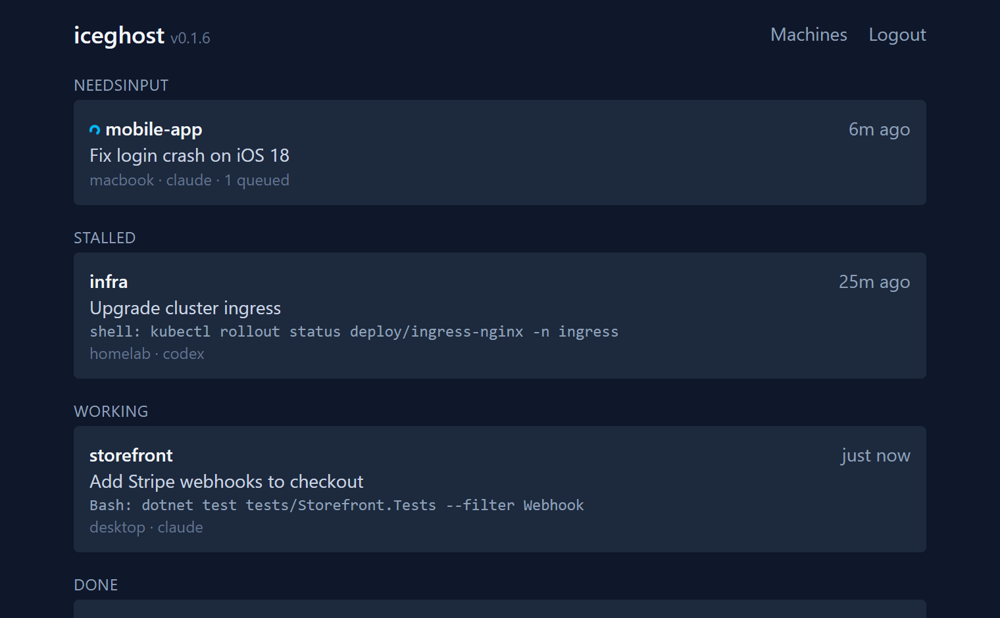
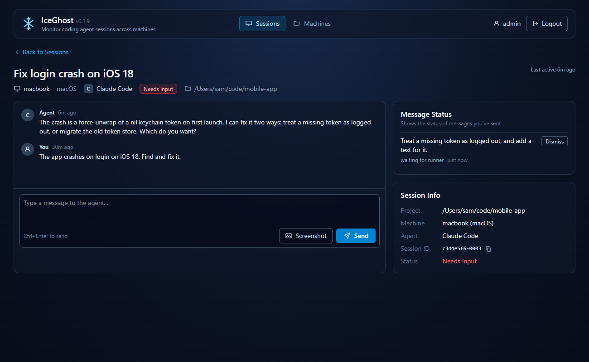
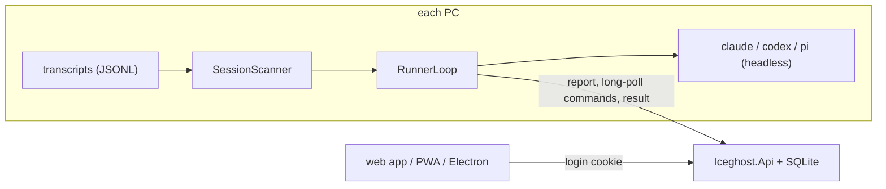

# Iceghost

See and control your coding agent sessions (Claude Code, Codex, pi) from anywhere.

You start a long agent session on a PC and walk away. It finishes, or it stops to ask you something, or it hangs, or the PC reboots. You find out hours later, and only by sitting at that machine. Iceghost fixes that across Windows, macOS and Linux:

- **See state.** A list of recent sessions from all your machines, each marked `working`, `needsInput`, `done` or `stalled`.
- **Send a message.** Type into the web app, PWA or desktop app; the session continues on its own machine.
- **Resume.** A session that stopped, hung or lost its process to a reboot is resumed headlessly by the same message.

There is no hook or plugin in the agent CLIs. A small runner on each PC reads the transcript files the CLIs already write.

| Sessions across your machines | One session: reply, follow progress |
| --- | --- |
|  |  |

<sub>Screenshots use sample data.</sub>

## How it works



1. The runner rescans transcripts every 15 s and reports the session list (a full list when something changed, and at least every 5 min).
2. You send a message in the UI. The server queues it as a command for that machine.
3. The runner long-polls for commands, runs the CLI headlessly in the session's working directory, posts the reply, then rescans and reports again. Commands run one at a time.

The prompt goes to the CLI on stdin, never on the command line. These are the exact commands (`EXTRA` is your `extraArgs` for that runtime, `ID` the session id):

| CLI | Command |
|---|---|
| Claude Code | `claude --print --output-format json EXTRA --resume ID` |
| Codex | `codex exec resume --json --skip-git-repo-check EXTRA ID -` |
| pi | `pi --mode json --print --no-extensions EXTRA --session-id ID` |

You can attach a screenshot to a message (Screenshot button, phone gallery or camera, or paste into the message box). It is resized to 2400 px, kept on the server only until the message finishes, saved on the PC under the runner's state dir `attachments/` (files are deleted after 7 days), and its path is appended to the prompt. Claude gets `--add-dir` for that folder.

The web app is a Vue SPA served by the API. The same SPA is the PWA and the Electron window.

## Session states

The runner classifies each session from the tail of its transcript:

| State | Rule |
|---|---|
| `working` | The turn has not ended and the last write was under 10 minutes ago (a pending tool call counts as working for its first 2 minutes). |
| `needsInput` | The turn ended and the last assistant message ends with `?`; or a tool call has been pending for 2 minutes up to 12 hours (usually a permission prompt). |
| `done` | The turn ended and the last assistant message does not end with `?`. |
| `stalled` | The turn has not ended and nothing was written for more than 10 minutes; or a tool call has been pending for 12 hours or more. Hung, killed or rebooted all look the same, and the remedy is the same: send a message to resume. |

While the runner executes a command for a session, that session shows `working`.

## Limits

- States are heuristics read from the transcript, not from the process. A question that does not end in `?` shows as `done`; a slow tool call shows as `needsInput` after 2 minutes.
- A Codex turn that ends with an error is shown as an assistant entry `error: ...`, and the session is `done`.
- Iceghost never kills a process. If a TUI is hung, resume the session from Iceghost (both append to the same transcript) and close the old TUI yourself.
- Headless Claude may block on a tool permission prompt. Pass a permission flag through `extraArgs` (see Enroll a machine), for example `--permission-mode acceptEdits`.
- The runner only acts on sessions in its own latest scan. A message for a session it has not listed fails with `unknown session on this machine`; the runtime and working directory always come from the scan, not from the server.
- Only the newest 50 transcripts modified in the last 14 days are listed. Each session shows its last 10 entries, each cut to 1000 characters. Subagent transcripts are skipped.
- One admin password. No invites, no new-session creation, no push notifications.
- A command times out after `timeoutMinutes` (default 30).

## Where sessions are found

The runner prints every root it scans at startup, with `(missing)` for ones that do not exist. Defaults and overrides:

| CLI | Default root | Overrides |
|---|---|---|
| Claude Code | `~/.claude/projects` | `CLAUDE_CONFIG_DIR` (uses `$CLAUDE_CONFIG_DIR/projects`) |
| Codex | `~/.codex/sessions` | `CODEX_HOME` (uses `$CODEX_HOME/sessions`) |
| pi | `~/.pi/agent/sessions` | `PI_CODING_AGENT_DIR` (the agent dir; sessions are under it); `PI_CODING_AGENT_SESSION_DIR` (the sessions dir itself); and a `sessionDir` string in `settings.json` in the agent dir is scanned in addition |
| any | | `roots` in the runner's `config.json`: a non-empty list for a CLI replaces that CLI's default. A leading `~/` is expanded |

Environment variables are read from the runner process. A service started by Task Scheduler, systemd or launchd does not inherit variables you set in your shell profile. If you use `CLAUDE_CONFIG_DIR` and friends, set them in the service definition, or put the paths in `roots` in `config.json`, which always works.

## Quick start (Docker Compose)

```
cp .env.example .env
# edit .env: set ICEGHOST_ADMIN_PASSWORD (12+ characters)
docker compose up -d
```

Open http://localhost:8080 (change the port with `ICEGHOST_PORT` in `.env`). The login cookie is Secure, so for anything beyond localhost put it behind HTTPS (see Deploy). Data lives in the `iceghost-data` volume. Then enroll a machine (below).

## Run from source

Needs the .NET SDK from `global.json`, and Node 22 with pnpm.

```
cp .env.example .env                     # set ICEGHOST_ADMIN_PASSWORD; set ICEGHOST_DEV=1 to allow http cookies
dotnet run --project src/Iceghost.Api    # http://localhost:5000
pnpm --dir web install
pnpm --dir web dev                       # Vite dev server, proxies /api to localhost:5000
```

Without `ICEGHOST_DEV=1` the auth cookie is `Secure` and browsers will not keep it over plain http. `pnpm --dir web build` writes the SPA into `src/Iceghost.Api/wwwroot`, so the API can serve it on its own.

## Configuration

Server environment variables. Real environment variables override `.env`; `.env` is looked up in the working directory, or at the path in `ICEGHOST_ENV_FILE`.

| Variable | Default | Meaning |
|---|---|---|
| `ICEGHOST_ADMIN_PASSWORD` | none, required | Admin login password, 12+ characters. The API refuses to start without it. |
| `ICEGHOST_DATA` | `./data` (`/data` in the image) | Directory for the SQLite database `iceghost.db`. |
| `ICEGHOST_DEV` | `0` | `1` allows the auth cookie over http. Leave `0` in production. |
| `ICEGHOST_PORT` | `8080` | Docker Compose only: host port to publish. |
| `ASPNETCORE_URLS` | `http://localhost:5000` in `.env.example` | Listen address when run from source. The image listens on 8080. |
| `ICEGHOST_ENV_FILE` | unset | Explicit path of the env file to load. |

The desktop app reads `ICEGHOST_URL` (see Desktop app).

## Deploy

1. Image: a push to `main` runs `.github/workflows/pipeline.yml`, which builds and pushes `skidvis/iceghost:latest` (repo secrets `DOCKER_USER` and `DOCKER_PASS`). By hand: `docker build -t skidvis/iceghost:latest . && docker push skidvis/iceghost:latest`. Use your own image name if you fork.
2. Kubernetes: `deploy/kubernetes.yaml` holds a Secret, a 1 Gi PersistentVolumeClaim for the SQLite file, a single-replica Deployment (strategy `Recreate`: one SQLite file, never two pods), a Service and an nginx Ingress. If you use flux-gitops, copy the file into your cluster's deployments directory. Edit the PVC `storageClassName`, the `TZ` value and the Ingress host to match your cluster.
3. Set the admin password: replace `REPLACE_ME` in the `iceghost-secrets` Secret with a password of at least 12 characters. Do not commit the real value.
4. Public hostname: the manifest's Ingress uses `iceghost.example.com` as its example host; change it to your domain. With a Cloudflare tunnel, go to **Cloudflare Zero Trust > Networks > Tunnels >** your tunnel **> Public Hostnames** and add:

   | Field | Value |
   |---|---|
   | Subdomain | `iceghost` |
   | Domain | your domain |
   | Service | the same in-cluster address your other site hostnames already use |

   Cloudflare creates the DNS record and terminates TLS at its edge. The domain must be in the same Cloudflare account as the tunnel. Any other HTTPS reverse proxy works too.

## Enroll a machine

1. Open your server (for example `https://iceghost.example.com`), log in with the admin password, go to Machines and add this PC by name. Copy the token it gives you; it is shown once.
2. Get the runner for your OS and architecture (`win-x64`, `win-arm64`, `osx-x64`, `osx-arm64`, `linux-x64`, `linux-arm64`):
   - **Release:** download `iceghost-runner-<tag>-<rid>.zip` (Windows) or `.tar.gz` (others) from GitHub Releases (published on `v*` tags) and check it against `SHA256SUMS`.
   - **CI build:** every push and pull request uploads `iceghost-runner-<rid>` artifacts to the Actions run (kept 14 days).

   Put the binary at `%LOCALAPPDATA%\Programs\IceghostRunner\iceghost-runner.exe` on Windows, or `~/.local/bin/iceghost-runner` on Linux and macOS (`chmod +x` it; a downloaded macOS binary may also need `xattr -d com.apple.quarantine`).
3. Run it once with the server and token. This saves `config.json` to the state dir and starts the loop:

   ```
   iceghost-runner run --server https://iceghost.example.com --token TOKEN
   ```

   `--state-dir PATH` overrides the state dir. After this, `iceghost-runner run` alone reuses the saved config.

State dir: `%LOCALAPPDATA%\Iceghost Runner` on Windows, `~/Library/Application Support/Iceghost Runner` on macOS, `$XDG_STATE_HOME/iceghost-runner` or `~/.local/state/iceghost-runner` on Linux. The file is `config.json`, mode 0600 on Unix. It holds the token, so keep it private.

`config.json` (camelCase; runtime keys are `claude`, `codex`, `pi`):

```json
{
  "server": "https://iceghost.example.com",
  "token": "TOKEN",
  "extraArgs": { "claude": ["--permission-mode", "acceptEdits"] },
  "timeoutMinutes": 30,
  "roots": { "pi": ["~/work/pi-sessions"] }
}
```

`extraArgs` are inserted before the session flag; `roots` replace a CLI's default roots (see Where sessions are found). Edit the file and restart the runner to apply.

## Run at startup

Each command below runs `iceghost-runner run` with the config saved by the enroll step.

**Windows** (Task Scheduler, at logon):

```
schtasks /create /tn iceghost-runner /sc onlogon /tr "\"%LOCALAPPDATA%\Programs\IceghostRunner\iceghost-runner.exe\" run"
```

**Linux** (systemd user unit). Save as `~/.config/systemd/user/iceghost-runner.service`:

```ini
[Unit]
Description=Iceghost runner

[Service]
ExecStart=%h/.local/bin/iceghost-runner run
Restart=always

[Install]
WantedBy=default.target
```

Then start it and keep user services running without a login session:

```
systemctl --user enable --now iceghost-runner
loginctl enable-linger $USER
```

**macOS** (LaunchAgent). Save as `~/Library/LaunchAgents/com.sharkjets.iceghost-runner.plist`, replacing `YOUR_USER`:

```xml
<?xml version="1.0" encoding="UTF-8"?>
<!DOCTYPE plist PUBLIC "-//Apple//DTD PLIST 1.0//EN" "http://www.apple.com/DTDs/PropertyList-1.0.dtd">
<plist version="1.0">
<dict>
  <key>Label</key>
  <string>com.sharkjets.iceghost-runner</string>
  <key>ProgramArguments</key>
  <array>
    <string>/Users/YOUR_USER/.local/bin/iceghost-runner</string>
    <string>run</string>
  </array>
  <key>RunAtLoad</key>
  <true/>
  <key>KeepAlive</key>
  <true/>
</dict>
</plist>
```

Then load it:

```
launchctl load ~/Library/LaunchAgents/com.sharkjets.iceghost-runner.plist
```

## Desktop app

The Electron shell is a thin window around the web app. Other origins open in the system browser.

```
cd electron
pnpm install
pnpm dist
```

Installers land in `electron/dist` (NSIS on Windows, DMG on macOS, AppImage on Linux). The server URL is `ICEGHOST_URL` if set, else the contents of `url.txt` in the app's user-data directory, else the built-in default (`https://iceghost.example.com`, the example host; set yours). `pnpm start` runs it unpackaged.

## Phone

Open your server's URL in the phone's browser, log in, and install it:

- **iOS (Safari):** Share, then Add to Home Screen.
- **Android (Chrome):** menu, then Install app (or Add to Home screen).

The manifest installs it as a standalone app. It needs HTTPS to be installable and to keep the login cookie.

## Security

- The server can make an enrolled PC run `claude`, `codex` or `pi` with any prompt the logged-in admin types, in the working directory of a session the runner reported. With a permissive `extraArgs` flag that is remote code execution on that PC as that user. Guard the admin password and machine tokens accordingly.
- Machine tokens are 32 random bytes (base64url), shown once and stored only as a SHA-256 hash. Deleting a machine revokes its token.
- The admin password is compared as SHA-256 digests in fixed time. The login endpoint has a global rate limit of 5 attempts per minute. It is global on purpose: behind a tunnel or ingress the client IP may be the same for everyone. The cost is that an attacker can lock you out for a minute.
- Auth cookie `ig_auth`: HttpOnly, Secure (unless `ICEGHOST_DEV=1`), SameSite Lax, 30 days sliding.
- CSRF: on top of SameSite, non-GET requests to `/api` are rejected with 403 when `Sec-Fetch-Site` is present and is not `same-origin` or `none`.
- The prompt is written to the CLI's stdin, so it never appears in process listings. The session id must match `[A-Za-z0-9][A-Za-z0-9._-]{0,127}`. Messages are 1 to 20000 characters. CLI error output sent back is redacted for bearer tokens and keys.
- Never commit `.env` (it is gitignored) or a real `config.json`.

## Development

| Path | What |
|---|---|
| `src/Iceghost.Contracts` | Shared types and JSON options |
| `src/Iceghost.Api` | ASP.NET minimal API, SQLite store, serves the SPA |
| `src/Iceghost.Runner` | The runner: scanner, loop, CLI adapters (self-contained single file per RID) |
| `web` | Vue 3 + Vite + Tailwind SPA, also the PWA |
| `electron` | Desktop shell |
| `deploy` | Kubernetes manifest |
| `tests/Iceghost.Tests` | xunit tests for all the .NET code |
| `docs/plans` | Design and plan notes |

```
dotnet test Iceghost.slnx
pnpm --dir web test
node --test electron/url.test.js
```

CI (`.github/workflows/ci.yml`) runs on every push and pull request: the .NET tests on Ubuntu, macOS and Windows, the web tests and build, and a runner build for all six RIDs uploaded as artifacts. `runner-release.yml` tests, builds and publishes a GitHub Release with archives and `SHA256SUMS` on `v*` tags. `pipeline.yml` builds the server image on pull requests and pushes it on `main`.

## Troubleshooting

- **`'pi' not found on PATH`** (or `claude`, `codex`): the runner's own environment, not your shell, must find the CLI. For a service, set `PATH` in the unit or plist. On Windows, npm `.cmd` shims are found through `PATHEXT`.
- **`token rejected: re-enroll this machine`** (exit 3): the machine was deleted or the token is wrong. Add the machine again in the UI and run `iceghost-runner run --server ... --token ...`.
- **`config.json is invalid`** (exit 2): fix or delete the file named in the message. **`run with --server and --token first`** (exit 2): there is no saved config yet.
- **Session not listed:** check the roots the runner printed at startup (`(missing)` means the directory does not exist; see Where sessions are found). Only the 50 newest transcripts touched in the last 14 days appear.
- **`unknown session on this machine`:** the session was not in the runner's latest scan; wait for the next scan (15 s) or see the point above.
- **`working directory not found`:** the session's recorded directory no longer exists.
- **`timed out after N min`:** raise `timeoutMinutes` in `config.json`.
- **Login works on localhost but not elsewhere:** the cookie is Secure; serve over HTTPS, or set `ICEGHOST_DEV=1` for local http only.
- **Headless Claude does nothing useful:** it is probably waiting on a permission; add a flag in `extraArgs`.

## License

TBD.
