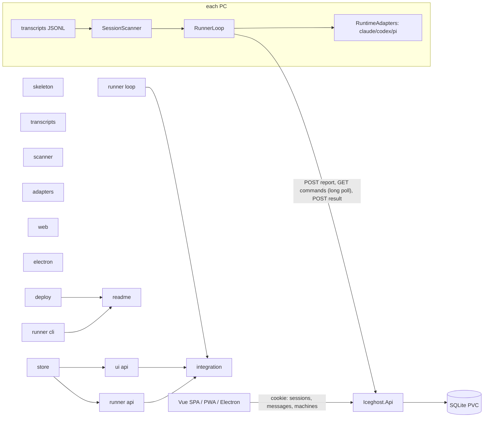

# iceghost: remote view and control of agent sessions

## Design

**User said:** runs pi, Claude Code and Codex sessions on Windows, Mac and Ubuntu and walks away; sessions end up completed, waiting on them, or hung, and reboots or end-task lose them. Wants desktop (Electron) and mobile apps listing recent sessions across machines with their state, and the ability to send a session a message, resuming it if it stopped. Server on the k8s cluster (flux-gitops), runner daemon on each PC.

**Chosen (batch answers):** headless resume; switchboard stack + PWA; cloudflared tunnel + tokens; AI orchestrator.

**Approach.** The runner reads transcript JSONL files the CLIs already write (`~/.claude/projects`, `~/.codex/sessions`, `~/.pi/agent/sessions`), so it needs no hooks and survives reboots. It classifies each session from its tail and reports to the server. A message is a queued command; the runner long-polls, runs the CLI headlessly in the session's cwd (`claude -p --resume`, `codex exec resume`, `pi --session-id`), posts the reply, and rescans. Adapters are ported from `switchboard\src\Switchboard.Runner\Runtime` with a working directory added. The UI is one Vue SPA served by the API; mobile installs it as a PWA, and Electron is a thin window around it.

States: `working`, `needsInput`, `done`, `stalled` (hung, killed or rebooted alike: the remedy is the same, resume).

- Ruling: no process kill (because finding a TUI's PID cross-platform from a session id is unreliable, and a hung TUI does not block a headless resume, since both append to the same JSONL; cost if wrong: the user closes the old TUI by hand).
- Ruling: Vite + Vue instead of Astro (because it is one SPA behind a login; cost: none, same Vue and Tailwind).
- Ruling: UI polls every 5 s instead of SSE (because it is simpler and fine for one user; cost: up to 5 s of lag).
- Ruling: admin login is one password from env `ICEGHOST_ADMIN_PASSWORD`, not switchboard's invite system (because there is one user).
- Ruling: no new-session creation and no push notifications (not asked; add later through gotify when a session turns `needsInput`).
- Ruling: deferred outward steps: pushing to GitHub, Docker Hub, copying the manifest into flux-gitops, the Cloudflare route. The plan writes the files and the README lists the steps.

# Plan

**Goal:** server, runner, web/PWA and Electron shell for iceghost, as designed above.
**Architecture:** see Design; diagram below.
**Tech stack:** .NET 10 (C#, minimal API, EF Core SQLite, xunit), Vue 3 + Vite + Tailwind 4 (pnpm, vitest), Electron.
**Spec:** plan.md
**Detail:** contracts
**Target-min:** 14

## Global constraints

- Layout: `Iceghost.slnx`; `src/Iceghost.Contracts` (classlib), `src/Iceghost.Api` (web), `src/Iceghost.Runner` (exe, self-contained single file per RID); one test project `tests/Iceghost.Tests` (xunit) referencing all three. Package versions in `Directory.Packages.props`, copied from switchboard's. `global.json` sdk 10.0.401, rollForward latestFeature. Nullable and ImplicitUsings on.
- Test command: `dotnet test Iceghost.slnx`; web: `pnpm --dir web test` and `pnpm --dir web build`. Slow tests carry `[Trait("Category","Slow")]`.
- JSON everywhere: `IceJson.Options` = Web defaults + `JsonStringEnumConverter(JsonNamingPolicy.CamelCase)` (`"claude"`, `"needsInput"`). The API uses the same converter.
- Limits: tail 10 entries, each text ≤ 1000 chars (cut, then `…`); message text 1..20000 chars; scan newest 50 files modified in the last 14 days.
- Classifier thresholds: `Stalled` after 10 min without writes; a pending tool call older than 2 min means `NeedsInput`.
- Runner state dir: Windows `%LOCALAPPDATA%\Iceghost Runner`, macOS `~/Library/Application Support/Iceghost Runner`, Linux `$XDG_STATE_HOME/iceghost-runner` or `~/.local/state/iceghost-runner`; `config.json` mode 0600 on Unix.
- Security: machine tokens are 32 random bytes in base64url, stored as SHA-256 hex; admin password compared in fixed time; cookie `ig_auth` HttpOnly, Secure (SameAsRequest only when `ICEGHOST_DEV=1`), SameSite Lax, 30 days sliding; API refuses to start when the password is unset or < 12 chars.
- Never read, copy or commit a real transcript's content into fixtures; write synthetic lines that mirror the real field structure.

```mermaid
%% schedule
gantt
  title Predicted schedule (mm:ss)
  dateFormat X
  axisFormat %M:%S
  section lane 1
  T10 web SPA :t10, 0, 320s
  section lane 2
  T4 runtime adapters :t4, 0, 212s
  T14 integration :t14, 302, 145s
  section lane 3
  T5 runner loop :t5, 0, 184s
  section lane 4
  T1 transcript reader :t1, 0, 174s
  section lane 5
  T7 store :t7, 0, 150s
  T9 UI endpoints :t9, 150, 152s
  section lane 6
  T3 scanner and classifier :t3, 0, 140s
  T8 runner endpoints :t8, 150, 147s
  section lane 7
  T0 skeleton :t0, 0, 124s
  T15 README :t15, 124, 100s
  section lane 8
  T13 deploy files :t13, 0, 124s
  section lane 9
  T6 runner CLI :t6, 0, 123s
  section lane 10
  T12 electron shell :t12, 0, 95s
```





critical path: T7 → T9 → T14 (7.4 min) · peak width 10 · predicted build 7.4 min · predicted total ≈ 10.9 min (target ✓)

## Contracts (T0, `src/Iceghost.Contracts/Contracts.cs`)

```csharp
public enum Runtime { Claude, Codex, Pi }
public enum SessionState { Working, NeedsInput, Done, Stalled }
public sealed record TranscriptEntry(string Role, string Text, DateTimeOffset At); // Role: user|assistant|tool
public sealed record SessionSnapshot(Runtime Runtime, string SessionId, string Cwd, string? Title, DateTimeOffset LastActivity, bool TurnEnded, bool PendingTool, IReadOnlyList<TranscriptEntry> Tail);
public sealed record SessionReport(Runtime Runtime, string SessionId, string Cwd, string? Title, SessionState State, DateTimeOffset LastActivity, IReadOnlyList<TranscriptEntry> Tail);
public sealed record RunnerReport(string Hostname, string Os, IReadOnlyList<SessionReport>? Sessions); // null = heartbeat, no change
public sealed record RunnerCommand(long Id, Runtime Runtime, string SessionId, string Cwd, string Text);
public sealed record CommandResult(bool Ok, string Output);
public static class IceJson { public static readonly JsonSerializerOptions Options; }
```

HTTP contract. Runner calls carry `Authorization: Bearer <token>`; 401 otherwise.
- `POST /api/runner/report` RunnerReport → 204
- `GET /api/runner/commands?waitSeconds=25` → 200 `RunnerCommand[]` (marks them delivered)
- `POST /api/runner/commands/{id}/result` CommandResult → 204, 404 when not this machine's
UI calls need cookie `ig_auth`; 401 otherwise.
- `POST /api/login {password}` → 204 + cookie, 401, 429 after 5/min; `POST /api/logout` → 204
- `GET /api/sessions` → `SessionRow[]`; `GET /api/sessions/{machineId}/{sessionId}` → `SessionDetail`
- `POST /api/sessions/{machineId}/{sessionId}/messages {text}` → 202 `{id}`, 400 bad length, 404
- `GET /api/machines` → `MachineRow[]`; `POST /api/machines {name}` → 201 `{id, token}`; `DELETE /api/machines/{id}` → 204
- `GET /healthz` → 200 `ok`

## File structure

| Path | Responsibility |
|---|---|
| src/Iceghost.Api/Program.cs | DI, auth, rate limit, static files, map endpoints (T0) |
| src/Iceghost.Api/Data/IceDb.cs, IceStore.cs | entities, all persistence |
| src/Iceghost.Api/Endpoints/RunnerEndpoints.cs, UiEndpoints.cs | HTTP routes |
| src/Iceghost.Runner/Scanning/* | transcript parsing, classification, file scan |
| src/Iceghost.Runner/Runtime/* | headless CLI adapters |
| src/Iceghost.Runner/Loop/* | server client, report/poll/execute loop |
| src/Iceghost.Runner/Program.cs, Cli/RunnerConfig.cs | CLI and saved config |
| web/ | SPA + PWA manifest |
| electron/ | desktop shell |
| Dockerfile, deploy/, .github/workflows/ | image, k8s manifest, CI |

## Package: runner

App type: CLI + file I/O + concurrency. Categories: file, encoding, state, protocol. Risks: a transcript being written mid-read (torn last line), huge files, CRLF, a 401 loop, two commands for one session at once.
**Probe entry:** run=dotnet run --project src/Iceghost.Runner

### T0 skeleton · Complexity 2 · Est. context 26k
**Owns:** Iceghost.slnx, global.json, Directory.Packages.props, .gitignore, src/Iceghost.Contracts/*, src/Iceghost.Api/Iceghost.Api.csproj, src/Iceghost.Api/Program.cs, src/Iceghost.Runner/Iceghost.Runner.csproj, tests/Iceghost.Tests/Iceghost.Tests.csproj, tests/Iceghost.Tests/ContractsTests.cs, every Produces stub below (throw NotImplementedException)
**Components:** 2
**LOC owned:** 150
**Tests:** fast
**Kind:** mechanical
**Model:** haiku
**Est. time:** 2.0 min
**Produces:** the Contracts block above; `Program.cs`: `IceStore` singleton at `$ICEGHOST_DATA/iceghost.db` (default `./data`), cookie auth `ig_auth`, rate limiter policy `login` (fixed window 5/min), `UseDefaultFiles`, `UseStaticFiles`, `MapFallbackToFile("index.html")`, `/healthz`, `app.MapRunnerEndpoints()`, `app.MapUiEndpoints()`, `public partial class Program`
**Test code:** `Enum_serializes_camel`: `JsonSerializer.Serialize(SessionState.NeedsInput, IceJson.Options)` == `"\"needsInput\""`; `Heartbeat_roundtrips`: `new RunnerReport("h","linux",null)` serializes to `{"hostname":"h","os":"linux","sessions":null}`
**Steps:** 1 write the files, 2 `dotnet build Iceghost.slnx`, 3 tests PASS

### T1 transcript reader · Complexity 5 · Est. context 32k
**Owns:** src/Iceghost.Runner/Scanning/TranscriptReader.cs, tests/Iceghost.Tests/TranscriptReaderTests.cs, tests/Iceghost.Tests/Fixtures/*.jsonl
**Components:** 3
**LOC owned:** 280
**Tests:** fast
**Model:** sonnet
**Est. time:** 3.0 min
**Produces:** `TranscriptReader.Read(Runtime runtime, IReadOnlyList<string> lines) -> SessionSnapshot?`
e.g. `Read(Runtime.Claude, [claude user line "fix it" at 10:00, assistant text "Done." stop_reason end_turn at 10:01])` -> `SessionSnapshot(Claude, "s1", "C:\\p", null, 10:01, TurnEnded: true, PendingTool: false, [user "fix it", assistant "Done."])`
e.g. `Read(Runtime.Pi, [session line, assistant toolCall, no toolResult])` -> `PendingTool: true, TurnEnded: false`
e.g. `Read(Runtime.Codex, [])` -> `null`
**Review Focus:** `Torn_last_line_ignored`: a last line `{"type":"assi` is skipped, the rest parses; `Crlf_lines`: lines ending `\r` parse; `Long_text_cut`: 5000-char text becomes 1000 chars ending `…`; `Claude_sidechain_skipped`: `isSidechain:true` lines don't count.
**Test code:** the three e.g. cases plus Review Focus; `Codex_task_complete_ends_turn`: session_meta (id,cwd), user response_item, assistant response_item, event_msg `task_complete` → TurnEnded true; `Claude_title_from_ai_title`: `{"type":"ai-title","aiTitle":"Fix login"}` → Title "Fix login"; `Codex_title_falls_back_to_first_user_text`.
**Notes:** formats: Claude lines carry `type` user|assistant, `sessionId`, `cwd`, `timestamp`, `message.content` (string or parts text|tool_use|tool_result), `message.stop_reason`; Codex has `session_meta.payload.{id,cwd}`, `response_item` payload message/function_call/function_call_output, `event_msg` payload `task_complete`; Pi has `type:"session"` `{id,cwd}`, `type:"message"` `message.role` user|assistant|toolResult, parts text|toolCall, `stopReason`. Check field names against the structure (not the content) of a local file under `~/.claude`, `~/.codex`, `~/.pi`. Tool results count as role `tool`.

### T3 scanner and classifier · Complexity 4 · Est. context 30k
**Owns:** src/Iceghost.Runner/Scanning/StateClassifier.cs, src/Iceghost.Runner/Scanning/SessionScanner.cs, tests/Iceghost.Tests/SessionScannerTests.cs
**Components:** 2
**LOC owned:** 200
**Tests:** fast
**Model:** sonnet
**Est. time:** 2.5 min
**Consumes:** TranscriptReader.Read(Runtime runtime, IReadOnlyList<string> lines) -> SessionSnapshot? (T1)
**Produces:** `StateClassifier.Classify(SessionSnapshot s, DateTimeOffset now) -> SessionState` · `ScanRoots.Default() -> ScanRoots` (record `ScanRoots(string ClaudeProjects, string CodexSessions, string PiSessions)`, honours `CLAUDE_CONFIG_DIR`, `CODEX_HOME`) · `SessionScanner(ScanRoots roots, Func<Runtime, IReadOnlyList<string>, SessionSnapshot?> read)` · `SessionScanner.Scan(DateTimeOffset now) -> IReadOnlyList<SessionReport>`
e.g. `Classify(turnEnded, last assistant "Ship it?", now)` -> `NeedsInput`; `Classify(turnEnded, "Done.")` -> `Done`
e.g. `Classify(not ended, 30 s old)` -> `Working`; `(not ended, pending tool, 3 min)` -> `NeedsInput`; `(not ended, 11 min)` -> `Stalled`
e.g. `Scan(now)` over a temp tree with one claude file -> `[SessionReport(Claude, "s1", "C:\\p", null, Done, …)]`
**Review Focus:** `Locked_file_read`: file open for writing by another FileStream (FileShare.ReadWrite) still scans; `Subagent_files_skipped`: paths containing `subagents` excluded; `Old_files_skipped`: mtime 15 days ago excluded; `Cap_50_newest`.
**Test code:** e.g. cases plus Review Focus, with a fake `read`.

### T4 runtime adapters · Complexity 5 · Est. context 40k
**Owns:** src/Iceghost.Runner/Runtime/*, tests/Iceghost.Tests/RuntimeAdapterTests.cs
**Components:** 4
**LOC owned:** 380
**Tests:** fast
**Model:** sonnet
**Est. time:** 3.6 min
**Produces:** `IRuntimeAdapter.SendAsync(RunnerCommand cmd, CancellationToken ct) -> Task<CommandResult>` · `RuntimeAdapters.For(Runtime runtime, IReadOnlyList<string> extraArgs, TimeSpan timeout) -> IRuntimeAdapter` · `FakeRuntimeAdapter(Func<RunnerCommand, CommandResult> reply) : IRuntimeAdapter`
e.g. `ClaudeAdapter.BuildArguments("s1", [])` -> `["--print","--output-format","json","--resume","s1"]`
e.g. `CodexAdapter.BuildArguments("t1", [])` -> `["exec","resume","--json","--skip-git-repo-check","t1","-"]`
e.g. `new FakeRuntimeAdapter(c => new(true, "echo " + c.Text)).SendAsync(cmd("hi"))` -> `CommandResult(true, "echo hi")`
**Notes:** port ProcessRuntimeAdapter, Claude/Codex/Pi adapters and output parsers from switchboard (path in Design), and drop its session-creation fallback: a missing session returns `CommandResult(false, "<runtime>: session not found")`. Set `WorkingDirectory = cmd.Cwd`; prompt via stdin where switchboard does; extraArgs go before the session flag; timeout kills the process tree and returns `(false, "timed out after N min")`; a missing exe returns `(false, "'claude' not found on PATH")`. Never throw.
**Review Focus:** `Extra_args_inserted`; `Missing_cwd_fails_cleanly`: cwd that does not exist -> Ok false, no throw; port switchboard's parser tests.
**Test code:** e.g. cases plus Review Focus.

### T5 runner loop · Complexity 6 · Est. context 36k
**Owns:** src/Iceghost.Runner/Loop/ServerClient.cs, src/Iceghost.Runner/Loop/RunnerLoop.cs, tests/Iceghost.Tests/RunnerLoopTests.cs
**Components:** 2
**LOC owned:** 260
**Tests:** slow
**Model:** sonnet
**Est. time:** 3.3 min
**Consumes:** SessionScanner.Scan(DateTimeOffset now) -> IReadOnlyList<SessionReport> (T3)
**Produces:** `ServerClient(HttpClient http, string token)` with `ReportAsync(RunnerReport r, CancellationToken ct) -> Task`, `PollAsync(CancellationToken ct) -> Task<IReadOnlyList<RunnerCommand>>`, `ResultAsync(long id, CommandResult r, CancellationToken ct) -> Task`; throws `UnauthorizedRunnerException` on 401 · `RunnerLoop(ServerClient client, Func<DateTimeOffset, IReadOnlyList<SessionReport>> scan, Func<Runtime, IRuntimeAdapter> adapters, TimeProvider time)` · `RunnerLoop.RunAsync(CancellationToken ct) -> Task`
e.g. first tick sends `RunnerReport(host, os, [2 sessions])`; an unchanged second tick sends `Sessions: null`
e.g. poll returns `[RunnerCommand(7, Claude, "s1", "C:\\p", "hi")]` -> adapter called once -> `ResultAsync(7, (true, "echo hi"))`, then an immediate full report
e.g. `RunAsync(ct)` against a server answering 401 -> throws `UnauthorizedRunnerException`; cancelling `ct` -> completes without throwing
**Notes:** adapters come in through the `adapters` Func (the `IRuntimeAdapter` interface from T4); tests pass their own fake. Scan every 15 s; while a command runs its session reports `Working`; commands run one at a time (`// ponytail: serial execution, per-session queues if two machines' worth of work piles up`); network errors back off 1, 2, 4 … 60 s; 401 ends RunAsync with UnauthorizedRunnerException.
**Review Focus:** `Unauthorized_stops_loop`; `Network_error_backs_off` (FakeTimeProvider); `Result_posted_when_adapter_fails`.
**Test code:** e.g. cases plus Review Focus with a fake HttpMessageHandler and FakeTimeProvider.

### T6 runner CLI · Complexity 3 · Est. context 24k
**Owns:** src/Iceghost.Runner/Program.cs, src/Iceghost.Runner/Cli/RunnerConfig.cs, tests/Iceghost.Tests/RunnerConfigTests.cs
**Components:** 2
**LOC owned:** 140
**Tests:** fast
**Kind:** mechanical
**Model:** haiku
**Est. time:** 1.9 min
**Produces:** `record RunnerConfig(string Server, string Token, Dictionary<Runtime, string[]> ExtraArgs, int TimeoutMinutes = 30)` · `RunnerConfig.StateDir() -> string` · `RunnerConfig.Load(string dir) -> RunnerConfig?` · `RunnerConfig.Save(string dir, RunnerConfig c) -> void` · CLI `iceghost-runner run [--server URL --token TOKEN] [--state-dir PATH]`
**Test code:** `Save_then_load_roundtrips`: Save(tmp, ("https://x","t",{},30)) then Load(tmp) equals it; `Load_missing_returns_null`; `Unix_mode_0600` (skipped on Windows): file mode == UserRead|UserWrite.
**Notes:** `run` with flags saves config first; without flags and no config it prints `run with --server and --token first` and exits 2; it wires ServerClient + SessionScanner(ScanRoots.Default(), TranscriptReader.Read) + RuntimeAdapters.For into RunnerLoop; Ctrl+C cancels cleanly; on UnauthorizedRunnerException it prints `token rejected: re-enroll this machine` and exits 3.

## Package: server

App type: HTTP service + auth. Categories: protocol, state, encoding; **security review required**. Risks: a machine reading or completing another machine's commands, token or password timing leaks, an unauthenticated UI route, stuck `delivered` commands after a runner reboot.
**Probe entry:** serve=src/Iceghost.Api

### T7 store · Complexity 5 · Est. context 34k
**Owns:** src/Iceghost.Api/Data/IceDb.cs, src/Iceghost.Api/Data/IceStore.cs, tests/Iceghost.Tests/IceStoreTests.cs
**Components:** 2
**LOC owned:** 280
**Tests:** fast
**Model:** sonnet
**Est. time:** 2.6 min
**Produces:** `IceStore(string dbPath)` (EnsureCreated; `// ponytail: EnsureCreated, add migrations at the first schema change`) · `CreateMachine(string name) -> (long Id, string Token)` · `Authenticate(string token) -> long?` · `ApplyReport(long machineId, RunnerReport r, DateTimeOffset now) -> void` · `ListSessions(DateTimeOffset now) -> IReadOnlyList<SessionRow>` · `GetSession(long machineId, string sessionId, DateTimeOffset now) -> SessionDetail?` · `Enqueue(long machineId, string sessionId, string text, DateTimeOffset now) -> long?` · `TakeCommands(long machineId, DateTimeOffset now) -> IReadOnlyList<RunnerCommand>` · `Complete(long machineId, long commandId, CommandResult r, DateTimeOffset now) -> bool` · `ListMachines() -> IReadOnlyList<MachineRow>` · `DeleteMachine(long id) -> bool`
Records in IceStore.cs: `SessionRow(long MachineId, string Machine, Runtime Runtime, string SessionId, string Cwd, string? Title, SessionState State, DateTimeOffset LastActivity, int PendingCommands)`, `CommandRow(long Id, string Text, string Status, string? Output, DateTimeOffset CreatedAt)` (Status queued|delivered|done|failed), `SessionDetail(SessionRow Session, IReadOnlyList<TranscriptEntry> Tail, IReadOnlyList<CommandRow> Commands)`, `MachineRow(long Id, string Name, string? Hostname, string? Os, DateTimeOffset? LastSeen)`
e.g. `Authenticate(CreateMachine("desk").Token)` -> `1`; `Authenticate("nope")` -> `null`
e.g. `Enqueue(1, "s1", "hi", t)` -> `1`; `TakeCommands(1, t)` -> `[RunnerCommand(1, Claude, "s1", "C:\\p", "hi")]`; a second `TakeCommands` -> `[]`
e.g. `ListSessions` -> rows newest LastActivity first
**Review Focus:** `Heartbeat_keeps_sessions` (null Sessions updates LastSeen only); `Report_replaces_sessions` (a session missing from a full report is removed); `Complete_other_machine_false`; `Delivered_after_60min_failed` (status failed, output `no result from runner`); `Delete_machine_cascades`.

### T8 runner endpoints · Complexity 4 · Est. context 30k
**Owns:** src/Iceghost.Api/Endpoints/RunnerEndpoints.cs, tests/Iceghost.Tests/RunnerEndpointsTests.cs
**Components:** 1
**LOC owned:** 160
**Tests:** slow
**Model:** sonnet
**Est. time:** 2.3 min
**Consumes:** IceStore methods (T7)
**Produces:** `RunnerEndpoints.MapRunnerEndpoints(this IEndpointRouteBuilder app) -> IEndpointRouteBuilder`
**Notes:** long poll checks the store every 1 s up to `waitSeconds` (clamped 0..50) and returns early once commands exist (`// ponytail: 1 s DB polling, signal per machine if latency matters`). Tests use WebApplicationFactory<Program> with `ICEGHOST_DATA` set to a temp dir.
**Review Focus:** `No_bearer_401`; `Wrong_token_401`; `Result_other_machine_404`; `Poll_returns_early_when_enqueued` (< 3 s with waitSeconds=25); `Wait_clamped`.

### T9 UI endpoints · Complexity 5 · Est. context 32k
**Owns:** src/Iceghost.Api/Endpoints/UiEndpoints.cs, tests/Iceghost.Tests/UiEndpointsTests.cs
**Components:** 1
**LOC owned:** 200
**Tests:** slow
**Model:** sonnet
**Est. time:** 2.6 min
**Consumes:** IceStore methods (T7)
**Produces:** `UiEndpoints.MapUiEndpoints(this IEndpointRouteBuilder app) -> IEndpointRouteBuilder`
**Review Focus:** `Every_ui_route_401_without_cookie` (sessions, detail, messages, machines GET/POST/DELETE); `Login_wrong_401`; `Login_sixth_try_429`; `Message_empty_400`, `Message_20001_400`; `Message_unknown_session_404`; `Token_shown_once` (GET /api/machines never contains a token); `Cookie_flags` (HttpOnly, SameSite=Lax).

## Package: clients

App type: web UI. Categories: protocol via its API, encoding (transcript text rendered as text, never `v-html`).
**Probe entry:** run=pnpm --dir web build

### T10 web SPA · Complexity 6 · Est. context 36k
**Owns:** web/
**Components:** 6
**LOC owned:** 560
**Tests:** slow
**Model:** sonnet
**Est. time:** 5.4 min
**Consumes:** the HTTP contract above (names only)
**Produces:** `ago(iso: string, now: Date) -> string` in web/src/format.ts
e.g. `ago("2026-10-25T10:00:00Z", new Date("2026-10-25T10:05:00Z"))` -> `"5m ago"`; 30 s -> `"just now"`; 26 h -> `"1d ago"`
**Notes:** Vite + Vue 3 + Tailwind 4 (`@tailwindcss/vite`), build output `../src/Iceghost.Api/wwwroot`, dev proxy `/api` to `http://localhost:5000`. Hash routes `#/` list, `#/s/:machineId/:sessionId` detail, `#/machines`. Any 401 shows Login. List: grouped by state (needsInput, stalled, working, done), shows machine, runtime, folder name, title, `ago`, and polls every 5 s. Detail: tail as chat bubbles, command history with status, a textarea and Send (Ctrl/Cmd+Enter), polls every 3 s. Machines: enroll by name shows the token once plus the copyable `iceghost-runner run --server <origin> --token <token>`; delete with confirm. `public/manifest.webmanifest` (name iceghost, display standalone, theme #0f172a) + `public/icon.svg`; mobile-first layout, dark by default.
**Review Focus:** `ago` cases in `web/src/format.test.ts`; no `v-html` anywhere (grep in test).

### T12 electron shell · Complexity 2 · Est. context 22k
**Owns:** electron/*
**Components:** 1
**LOC owned:** 80
**Tests:** fast
**Kind:** mechanical
**Model:** haiku
**Est. time:** 1.5 min
**Produces:** `resolveUrl(env: object, saved: string | null) -> string` in electron/url.js
**Test code:** `electron/url.test.js` (node:test): `resolveUrl({ICEGHOST_URL:"https://a"}, "https://b")` -> `"https://a"`; `resolveUrl({}, "https://b")` -> `"https://b"`; `resolveUrl({}, null)` -> `"https://iceghost.example.com"`.
**Notes:** main.js: one BrowserWindow loading `resolveUrl(process.env, <userData>/url.txt contents or null)`; links to other origins open in the system browser. package.json: electron, electron-builder (nsis, dmg, AppImage), scripts `start`, `dist`, `test` = `node --test`.

## Package: ship

App type: file generator. Categories: file.

### T13 deploy files · Complexity 2 · Est. context 26k
**Owns:** Dockerfile, .dockerignore, deploy/kubernetes.yaml, .github/workflows/ci.yml, .github/workflows/pipeline.yml, .github/workflows/runner-release.yml, tests/Iceghost.Tests/DeployFilesTests.cs
**Components:** 2
**LOC owned:** 150
**Tests:** fast
**Kind:** mechanical
**Model:** haiku
**Est. time:** 1.9 min
**Notes:** Dockerfile modeled on switchboard's (node stage builds web, sdk publishes Iceghost.Api, chiseled aspnet runtime, user 1654, `/data` volume, port 8080, `ENTRYPOINT ["./Iceghost.Api"]`). kubernetes.yaml in flux-gitops style (copy the shape of `your-gitops-repo/clusters/my-cluster/deployments/other-app.yaml`): Secret `iceghost-secrets` with `admin-password: REPLACE_ME`, PVC `standard` 1Gi RWO, Deployment `Recreate` with image `skidvis/iceghost:latest`, env `ICEGHOST_DATA=/data`, `TZ=UTC`, readinessProbe `/healthz`; Service port 80→8080; nginx Ingress host `iceghost.example.com`. pipeline.yml: push to main → docker build and push the image. runner-release.yml: tag `v*` → test on 3 OSes, publish 6 RIDs (win/linux/osx × x64/arm64) self-contained single-file, zip on Windows, tar.gz elsewhere, `.sha256` per archive, attach to a GitHub Release.
**Test code:** `Dockerfile_entrypoint` contains `ENTRYPOINT ["./Iceghost.Api"]`; `Manifest_host` contains `host: iceghost.example.com`; `Manifest_recreate` contains `type: Recreate`; `Release_six_rids` runner-release.yml contains all 6 RIDs.

### T14 integration · Complexity 5 · Est. context 34k
**Owns:** tests/Iceghost.Tests/EndToEndTests.cs
**Components:** 1
**LOC owned:** 150
**Tests:** slow
**Model:** sonnet
**Est. time:** 2.4 min
**Consumes:** MapRunnerEndpoints (T8) · MapUiEndpoints (T9) · RunnerLoop.RunAsync(CancellationToken ct) -> Task (T5)
**Test code:** `Message_round_trip`: WebApplicationFactory server; login; POST /api/machines → token; RunnerLoop with that token, a temp transcript tree holding one synthetic claude session, and a FakeRuntimeAdapter answering `"echo " + text`; within 10 s GET /api/sessions lists `s1` as `done`; POST message "hi"; within 10 s the detail shows a command `done` with output `echo hi`. `Revoked_machine_stops_runner`: DELETE the machine → RunAsync ends with UnauthorizedRunnerException.

### T15 README · Complexity 2 · Est. context 24k
**Owns:** README.md, tests/Iceghost.Tests/ReadmeTests.cs
**Components:** 1
**LOC owned:** 150
**Tests:** fast
**Kind:** mechanical
**Model:** haiku
**Est. time:** 1.6 min
**Test code:** `Readme_headings`: README.md contains the lines `## Deploy`, `## Enroll a machine`, `## Run at startup`, `## Desktop app`, `## Phone`.
**Notes:** sections: what it is; Deploy (build and push the image, copy deploy/kubernetes.yaml into flux-gitops `clusters/my-cluster/deployments/iceghost.yaml`, set the password, add the Cloudflare public hostname `iceghost.example.com` like the sgtm doc's step 2); Enroll a machine; Run at startup: Windows Task Scheduler at logon (`schtasks /create /sc onlogon ...`), Linux systemd `--user` unit with `Restart=always` and `loginctl enable-linger`, macOS LaunchAgent plist with `KeepAlive`; Desktop app (electron `pnpm dist`); Phone (open the URL and Add to Home Screen); Limits (no process kill, heuristic states).

### T16 public repo hardening · Complexity 3 · Est. context 26k
**Owns:** .env.example, docker-compose.yml, src/Iceghost.Api/DotEnv.cs, tests/Iceghost.Tests/DotEnvTests.cs, tests/Iceghost.Tests/SecretScanTests.cs
**Components:** 2
**LOC owned:** 150
**Tests:** fast
**Model:** sonnet
**Est. time:** 2.0 min
**Notes:** follow-up from the live test and the public-repo request; spec in `.superlite/fixes/F-SEC-1.md`. Gitignored `.env` loaded at startup (real env vars win), no Secret object in deploy/kubernetes.yaml, a secret-pattern scan over tracked files.

## Review Focus

Runner: torn lines, locked files, CRLF, 401 stop, serial execution, never throwing from adapters. Server: cross-machine isolation, auth on every route, fixed-time compares, stuck delivered commands. Web: no `v-html`. Security review (Opus) on T7, T8, T9.

## Self-review

Coverage: sessions list and state (T1, T3, T7, T9, T10), multi-machine (T7), message and resume (T4, T5, T8), reboot survival (transcripts + startup docs T15), k8s deploy (T13), Electron (T12), mobile PWA (T10), Windows/Mac/Linux (T4 adapters, T13 RIDs, T15). No placeholders; every Consumes matches a Produces; edges are only where tests run another task's code.
